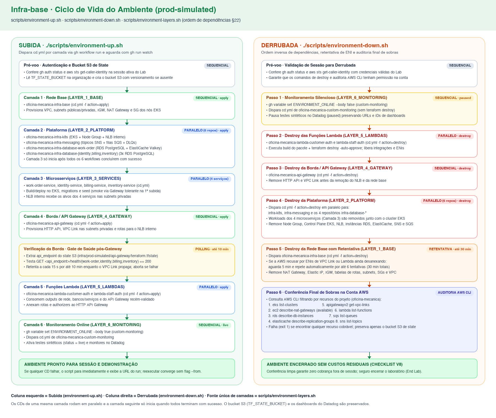

# Runbook da Sessão — Ambiente `prod-simulated` (AWS Academy)

Este runbook descreve o procedimento operacional completo para iniciar, operar e encerrar uma sessão do ambiente `prod-simulated` da solução **Oficina Mecânica** no AWS Academy Learner Lab, cobrindo tanto a automação de subida e derrubada por script quanto os passos manuais previstos na arquitetura (AD-26, §8.6, §13.3, §22 e V8 da §25).

---

## 1. Pré-requisitos na máquina do operador

Antes de iniciar a sessão, confirme que as ferramentas abaixo estão instaladas e disponíveis no terminal:

- **Bash** (`>= 4` ou compatível POSIX/macOS/Linux com `set -euo pipefail`)
- **GitHub CLI (`gh`)** autenticado com permissão de escrita em variáveis e disparo de workflows nos repositórios da organização `FIAP-15SOAT` (`gh auth status`)
- **AWS CLI v2 (`aws`)**
- **`jq`** e **`curl`**

---

## 2. Conferência de crédito no painel do AWS Academy (Checklist V8)

O AWS Academy Learner Lab fornece um orçamento limitado em dólares (USD) para todo o período da disciplina. Recursos como **EKS Control Plane**, **NAT Gateway**, **nós EC2**, **RDS PostgreSQL** e **ElastiCache for Valkey** consomem crédito continuamente enquanto permanecem provisionados.

Antes de iniciar qualquer subida do ambiente:

1. Acesse o painel do **AWS Academy Learner Lab** da turma.
2. Verifique o indicador **Remaining Credit** (crédito restante vs. orçamento total) no topo do painel:
   - Anote o valor restante em USD no registro da sessão/entrega antes de clicar em **Start Lab**.
   - Se o saldo restante estiver próximo do limite crítico para as demonstrações e validações pendentes, avalie se é necessário subir toda a malha ou apenas validar camadas específicas.
3. Clique em **Start Lab** e aguarde até que o indicador de status do laboratório passe de amarelo para **verde**.
4. Ao final da sessão, **nunca** encerre apenas o painel do laboratório (`End Lab`) sem antes executar `./scripts/environment-down.sh` e confirmar que todos os recursos foram destruídos: pausar o laboratório sem destruir os stacks mantém cobranças por hora de recursos persistentes (como RDS, NAT Gateway e volumes EBS).

---

## 3. Atualização das credenciais do Lab nos secrets da organização

Cada sessão de 4 horas do AWS Academy gera um novo par de chaves temporárias e um novo `aws_session_token`. Tanto os workflows de CD no GitHub Actions quanto os scripts locais (`environment-up.sh` e `environment-down.sh`) dependem dessas credenciais atualizadas.

1. No painel do AWS Academy Learner Lab (com o status **verde**), clique em **AWS Details** e, na linha **AWS CLI**, clique em **Show**.
2. Copie os valores de `aws_access_key_id`, `aws_secret_access_key` e `aws_session_token` e exporte-os no seu terminal (ou atualize `~/.aws/credentials`):

```bash
# Exportar as credenciais temporárias da sessão ativa do AWS Academy no shell local
export AWS_ACCESS_KEY_ID="<aws_access_key_id>"
export AWS_SECRET_ACCESS_KEY="<aws_secret_access_key>"
export AWS_SESSION_TOKEN="<aws_session_token>"
export AWS_DEFAULT_REGION="us-east-1"

# Confirmar que a sessão AWS local está autenticada na conta do laboratório
aws sts get-caller-identity
```

3. Atualize os três secrets de Actions no escopo da organização `FIAP-15SOAT` usando o GitHub CLI:

```bash
# Atualizar AWS_ACCESS_KEY_ID nos secrets da organização
gh secret set AWS_ACCESS_KEY_ID --org FIAP-15SOAT --body "$AWS_ACCESS_KEY_ID"

# Atualizar AWS_SECRET_ACCESS_KEY nos secrets da organização
gh secret set AWS_SECRET_ACCESS_KEY --org FIAP-15SOAT --body "$AWS_SECRET_ACCESS_KEY"

# Atualizar AWS_SESSION_TOKEN nos secrets da organização
gh secret set AWS_SESSION_TOKEN --org FIAP-15SOAT --body "$AWS_SESSION_TOKEN"
```

> **Nota sobre conta AWS nova:** se o ID da conta AWS (`Account` retornado por `aws sts get-caller-identity`) tiver mudado em relação à última sessão, atualize também a variável da organização `TF_STATE_BUCKET` (`gh variable set TF_STATE_BUCKET --org FIAP-15SOAT --body "bkt-oficina-mecanica-<account_id>"`). O script `environment-up.sh` criará o bucket S3 automaticamente com versionamento habilitado se ele ainda não existir na conta.

---

## 4. Subida completa do ambiente (`scripts/environment-up.sh`)

Com as credenciais válidas tanto no shell local quanto nos secrets da organização `FIAP-15SOAT`, dispare a subida completa a partir da raiz deste repositório (`oficina-mecanica-infra-base`):

```bash
# Subir todas as camadas do ambiente prod-simulated na ordem de dependências da arquitetura
./scripts/environment-up.sh
```



### O que o script executa em cada etapa

| Ordem | Etapa / Camada | Repositórios / Ações | Modo | Tempo estimado |
| --- | --- | --- | --- | --- |
| **Pré-voo** | Validação e bucket de state | Confere `gh auth status` e `aws sts get-caller-identity`; lê `TF_STATE_BUCKET` via API do GitHub e cria o bucket S3 com versionamento se `head-bucket` falhar | Sequencial | ~5 s |
| **Camada 1** | Rede base (`LAYER_1_BASE`) | `oficina-mecanica-infra-base` (`action=apply`) | Sequencial | ~3–4 min |
| **Camada 2** | Plataforma (`LAYER_2_PLATFORM`) | `oficina-mecanica-infra-k8s`, `oficina-mecanica-infra-messaging`, `oficina-mecanica-infra-database-work-order`, `oficina-mecanica-infra-database-identity`, `oficina-mecanica-infra-database-billing`, `oficina-mecanica-infra-database-inventory` (`action=apply`) | Paralelo | ~12–18 min |
| **Camada 3** | Microsserviços (`LAYER_3_SERVICES`) | Workflows `cd.yml` dos microsserviços declarados em `scripts/environment-layers.sh` (implantação no EKS, migrations e seed quando aplicável) | Paralelo | ~3–6 min |
| **Camada 4** | Borda (`LAYER_4_GATEWAY`) | `oficina-mecanica-api-gateway` (`action=apply`) | Sequencial | ~2–4 min |
| **Pós-Camada 4** | Conferência de saúde da borda | Consulta `GET /health/<contexto>` (`work-order`, `identity`, `billing`, `inventory`) pelo `api_endpoint` público do API Gateway, com retentativa a cada 15 s por até 10 min | Sequencial | ~1–5 min |
| **Camada 5** | Funções Lambda (`LAYER_5_LAMBDAS`) | `oficina-mecanica-lambda-customer-auth` (e demais Lambdas registradas na camada) (`action=apply`) | Paralelo | ~2–3 min |
| **Camada 6** | Monitoramento (`LAYER_6_MONITORING`) | Define `ENVIRONMENT_ONLINE=true` no repositório `oficina-mecanica-custom-monitoring` e dispara seu `cd.yml` para ativar os testes sintéticos (`live`) | Sequencial | ~1–2 min |

> **Retomada após falha parcial:** os workflows de CD são idempotentes (`terraform apply` sem alterações nas stacks já convergidas e reimplantação segura dos serviços). Não há flag `--from`: se uma camada falhar, corrija a causa (por exemplo, renove credenciais expiradas) e execute `./scripts/environment-up.sh` novamente.

---

## 5. Atualização da URL do webhook no painel do Mercado Pago (§13.3)

Como o HTTP API Gateway (`oficina-mecanica-api-gateway`) é destruído ao fim de cada sessão e recriado na sessão seguinte, o domínio público gerado pela AWS (`https://<api_id>.execute-api.us-east-1.amazonaws.com`) muda a cada bootstrap. Quando a sessão envolver testes reais ou simulados de pagamento via Mercado Pago:

1. Obtenha o `api_endpoint` da sessão ativa — ele é impresso pelo `environment-up.sh` na etapa de conferência da borda (`Gateway endpoint: https://...`), ou pode ser consultado diretamente no bucket de state:

```bash
# Ler a variável TF_STATE_BUCKET visível ao repositório e extrair o api_endpoint do state do gateway
TF_STATE_BUCKET="$(gh api repos/FIAP-15SOAT/oficina-mecanica-infra-base/actions/organization-variables --jq '.variables[] | select(.name=="TF_STATE_BUCKET") | .value')"
aws s3 cp "s3://${TF_STATE_BUCKET}/infra/prod-simulated/api-gateway/terraform.tfstate" - \
  | jq -r '.outputs.api_endpoint.value'
```

2. Monte a URL completa do webhook de pagamento:

```text
<api_endpoint>/webhooks/mercadopago
```

3. No painel [Mercado Pago Developers](https://www.mercadopago.com.br/developers/panel/app):
   - Acesse **Suas integrações** e selecione a aplicação utilizada pelo projeto.
   - No menu lateral, clique em **Webhooks** → **Configurar notificações**.
   - Atualize a **URL de produção** (e/ou **URL de teste**) para `<api_endpoint>/webhooks/mercadopago`.
   - Certifique-se de que o evento **Order (Mercado Pago)** (ou *Pagamentos* conforme a integração ativa) esteja selecionado e clique em **Salvar configuração**.

---

## 6. Limpeza do cache de um serviço no ElastiCache for Valkey (§8.6)

Durante sessões de depuração, demonstração ou ajustes manuais diretamente no banco de dados PostgreSQL de um serviço, pode ser necessário invalidar as chaves cacheadas daquele contexto no **ElastiCache for Valkey** sem afetar outros contextos nem destruir o cluster de cache.

Como o ElastiCache fica isolado nas subnets privadas e aceita tráfego apenas a partir do Security Group de identidade dos nós do EKS (`secgrp-eks-nodes-oficina-mecanica`), execute a limpeza a partir de um pod do próprio serviço:

1. Atualize o contexto local do `kubectl` apontando para o cluster EKS da sessão:

```bash
# Configurar o kubeconfig local para o cluster eks-oficina-mecanica
aws eks update-kubeconfig --name eks-oficina-mecanica --region us-east-1
```

2. Execute o `redis-cli --tls` com `--scan --pattern '<contexto>:*'` dentro do deployment do serviço para remover apenas as chaves pertencentes àquele prefixo:

```bash
# Limpar todas as chaves do contexto work-order no ElastiCache for Valkey via TLS
kubectl exec -n work-order deploy/work-order-service -- sh -c \
  'redis-cli --tls -u "$REDIS_URL" --scan --pattern "work-order:*" | xargs -r redis-cli --tls -u "$REDIS_URL" DEL'
```

Caso o container do serviço exponha o host, a porta e o token em variáveis separadas (`REDIS_HOST`, `REDIS_PORT`, `REDIS_AUTH_TOKEN`) em vez de `REDIS_URL`, utilize:

```bash
# Alternativa usando variáveis separadas de host, porta e autenticação TLS
kubectl exec -n work-order deploy/work-order-service -- sh -c \
  'REDISCLI_AUTH="$REDIS_AUTH_TOKEN" redis-cli --tls -h "$REDIS_HOST" -p "${REDIS_PORT:-6379}" --scan --pattern "work-order:*" | xargs -r env REDISCLI_AUTH="$REDIS_AUTH_TOKEN" redis-cli --tls -h "$REDIS_HOST" -p "${REDIS_PORT:-6379}" DEL'
```

---

## 7. Derrubada completa do ambiente (`scripts/environment-down.sh`)

Ao encerrar o trabalho na sessão — e **enquanto as credenciais do AWS Academy ainda estiverem válidas** — execute o script de derrubada a partir da raiz deste repositório:

```bash
# Derrubar todas as camadas na ordem inversa e auditar que não restaram recursos cobrando na conta
./scripts/environment-down.sh
```

### Ordem de derrubada e auditoria final

1. **Monitoramento silencioso (`LAYER_6_MONITORING`)**: define `ENVIRONMENT_ONLINE=false` em `oficina-mecanica-custom-monitoring` e dispara seu CD. Os dashboards e monitores no Datadog são preservados (mantendo seus IDs e URLs estáveis entre sessões), mas os testes sintéticos entram em estado `paused` para evitar alertas falsos com o ambiente desligado.
2. **Funções Lambda (`LAYER_5_LAMBDAS`)**: dispara `cd.yml` com `action=destroy` em paralelo.
3. **API Gateway (`LAYER_4_GATEWAY`)**: dispara `cd.yml` com `action=destroy`, removendo o HTTP API e o VPC Link.
4. **Plataforma (`LAYER_2_PLATFORM`)**: dispara `cd.yml` com `action=destroy` em paralelo para `infra-k8s`, `infra-messaging` e os 4 repositórios `infra-database*`. Os workloads dos microsserviços da Camada 3 são encerrados junto com a remoção do cluster EKS e do NLB interno.
5. **Rede base (`LAYER_1_BASE`)**: dispara `cd.yml` do `oficina-mecanica-infra-base` com `action=destroy`. Caso a AWS recuse a exclusão da VPC/subnets por dependências residuais de ENIs (comum após destruir VPC Link e Lambdas em VPC), o script aguarda 5 minutos e repete a tentativa automaticamente por até **30 minutos** (6 tentativas).
6. **Conferência final de sobras**: consulta a AWS CLI (`eks`, `ec2 describe-nat-gateways`, `rds`, `elasticache`, `apigatewayv2 get-vpc-links`, `lambda`, `sqs` e `sns`) filtrando pelo prefixo do projeto (`oficina-mecanica` / `eks-oficina-mecanica`). Se qualquer recurso ainda existir (exceto o bucket S3 de state), o script lista as sobras e termina com código de saída diferente de zero (`exit 1`).

---

## 8. Falhas conhecidas e resolução de problemas

### 8.1. Credencial do AWS Academy expirada no meio da subida ou da derrubada

- **Sintoma:** um job de CD falha no step `Configure AWS Credentials` (ou durante o `terraform plan`/`apply`/`destroy`) com erro `ExpiredToken`, `InvalidClientTokenId` ou `UnrecognizedClientException`, interrompendo o script com o link da execução que falhou.
- **Causa:** a sessão de 4 horas do AWS Academy Learner Lab expirou ou foi reiniciada, invalidando o `AWS_SESSION_TOKEN`.
- **Como resolver:**
  1. Confirme que o laboratório está ativo (indicador verde) no painel do AWS Academy.
  2. Obtenha as novas credenciais em **AWS Details → AWS CLI: Show**.
  3. Atualize as variáveis no seu terminal e nos secrets da organização (`gh secret set AWS_ACCESS_KEY_ID ...`, `AWS_SECRET_ACCESS_KEY`, `AWS_SESSION_TOKEN` conforme a [Seção 3](#3-atualização-das-credenciais-do-lab-nos-secrets-da-organização)).
  4. Execute novamente `./scripts/environment-up.sh` (ou `./scripts/environment-down.sh`). As camadas já concluídas serão reaplicadas rapidamente sem recriar recursos existentes.

### 8.2. VPC Link ou integração privada demorando após o apply do API Gateway

- **Sintoma:** logo após o término da Camada 4 (`oficina-mecanica-api-gateway`), as primeiras chamadas da etapa de conferência da borda (`GET <api_endpoint>/health/<contexto>`) retornam `500`, `502` ou `503`.
- **Causa:** o provisionamento interno das ENIs do VPC Link V2 e o registro inicial dos alvos no Network Load Balancer (NLB) interno do EKS podem levar alguns minutos adicionais após a API da AWS reportar o recurso como `AVAILABLE`.
- **Como resolver:**
  - O `environment-up.sh` já aguarda e repete a verificação a cada **15 segundos por até 10 minutos** para cada contexto (`work-order`, `identity`, `billing`, `inventory`).
  - Se um serviço não responder `200` após os 10 minutos, verifique a saúde dos pods e do Service no cluster EKS:
    ```bash
    aws eks update-kubeconfig --name eks-oficina-mecanica --region us-east-1
    kubectl get pods,svc -A
    ```

### 8.3. ENI presa (`DependencyViolation`) ao destruir a rede base (`infra-base`)

- **Sintoma:** durante o `./scripts/environment-down.sh`, a primeira execução do `destroy` em `oficina-mecanica-infra-base` falha no Terraform com erro `DependencyViolation: The subnet 'subnet-...' has dependencies and cannot be deleted` ou `The vpc 'vpc-...' has dependencies`.
- **Causa:** após a destruição de funções AWS Lambda anexadas à VPC ou do VPC Link do API Gateway, o plano de controle da AWS pode levar de 5 a 20 minutos para desanexar e excluir completamente as Elastic Network Interfaces (ENIs) gerenciadas.
- **Como resolver:**
  - Nenhuma ação imediata é necessária na primeira falha: o `environment-down.sh` retenta automaticamente o `destroy` do `infra-base` a cada **5 minutos por até 30 minutos**.
  - Caso todas as 6 tentativas falhem após 30 minutos, inspecione quais ENIs ainda estão anexadas à VPC para identificar o recurso bloqueador:
    ```bash
    aws ec2 describe-network-interfaces \
      --filters "Name=tag:Project,Values=oficina-mecanica" \
      --query 'NetworkInterfaces[].{ID:NetworkInterfaceId,Status:Status,Type:InterfaceType,Description:Description}' \
      --output table
    ```

### 8.4. Criação do ElastiCache negada pelas políticas da conta do AWS Academy

- **Sintoma:** o workflow de CD do `oficina-mecanica-infra-database-work-order` (ou de outro repositório que provisione cache gerenciado) falha no `terraform apply` com erro `AccessDenied` ou restrição de IAM em `elasticache:CreateReplicationGroup`.
- **Causa:** determinadas contas ou revisões de política do AWS Academy Learner Lab podem restringir a criação de replication groups do Amazon ElastiCache ou tipos de nó específicos.
- **Como resolver:**
  - Verifique primeiro se o `node_type` está configurado como `cache.t3.micro` e `num_cache_clusters = 1`.
  - Se o serviço `elasticache` estiver bloqueado pela política da conta do laboratório, aplique a contingência prevista na arquitetura (§8.6): implante uma instância efêmera do **Valkey** (`valkey/valkey:8.0-alpine`) como Deployment e ClusterIP Service dentro do próprio namespace do serviço no EKS e aponte a variável de conexão `REDIS_HOST` / `REDIS_URL` do microsserviço para o Service local do cluster.
